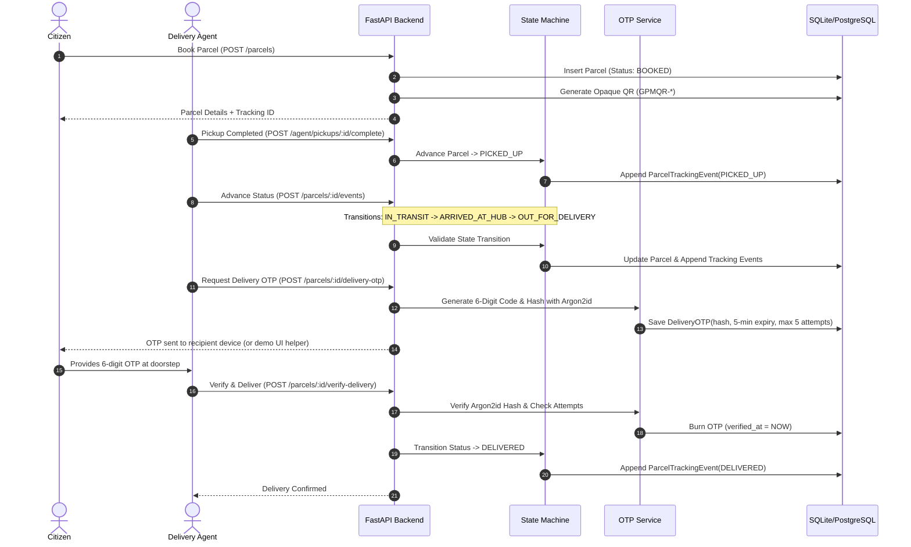

# Module 2 — Technical Architecture Specification

**Project**: AI-Powered Intelligent Government Postal Management and Information Retrieval System  
**Module**: Module 2 — QR-Based Parcel Tracking & Secure Delivery  
**Status**: Implemented and Verified  
**Disclaimer**: Academic prototype for research purposes. Not official India Post software.

---

## 1. Executive Summary

Module 2 extends the postal management platform by delivering end-to-end consignment visibility and cryptographic handover verification. It introduces:
1. **Opaque QR Code Generation and Public Resolution**: Eliminates enumeration vulnerabilities by separating internal primary keys from tracking tokens.
2. **Deterministic Parcel Tracking State Machine**: Enforces a strict, irreversible transition lifecycle from `BOOKED` through `DELIVERED`.
3. **Privacy-Preserving Public Tracking**: Sanitizes citizen and recipient identities in unauthenticated public queries.
4. **Argon2id-Protected Delivery OTP Verification**: Replaces paper signatures with cryptographic proof-of-delivery, preventing replay attacks and brute-force guessing.

---

## 2. Architectural Boundaries

```text
+-----------------------------------------------------------------------------+
|                          MODULE 1 (Foundation)                              |
|  - Citizen Registration & Auth (JWT)                                        |
|  - Parcel Booking (GPM-YYYY-NNNNNN)                                         |
|  - Doorstep Pickup Scheduling & Workload-Aware Assignment                   |
+-----------------------------------------------------------------------------+
                                      │
                                      ▼
+-----------------------------------------------------------------------------+
|                     MODULE 2 (Tracking & Secure Delivery)                   |
|  - Opaque QR Token Generation (GPMQR-*)                                      |
|  - Public Tracking Resolution (Privacy-Shielded)                            |
|  - Tracking State Machine (BOOKED -> PICKED_UP -> IN_TRANSIT ->             |
|    ARRIVED_AT_HUB -> OUT_FOR_DELIVERY -> DELIVERY_ATTEMPTED -> DELIVERED)  |
|  - Delivery OTP (Argon2id Hashed, 5-Min Expiry, Max 5 Attempts)             |
|  - Atomic Handover & Immutable Audit Logging                                |
+-----------------------------------------------------------------------------+
                                      │
                      [STRICT ARCHITECTURAL BOUNDARY]
                                      │
+─────────────────────────────────────────────────────────────────────────────+
|               FUTURE MODULES (DO NOT IMPLEMENT NOW)                         |
|  - Module 3: AI Document Processing, OCR & Postal Information Retrieval     |
|  - Module 4: Route Optimization, ETA Prediction & Logistics AI              |
|  - Module 5: Public Grievances, Analytics & Executive Dashboards            |
+─────────────────────────────────────────────────────────────────────────────+
```

---

## 3. Core Component Interactions


